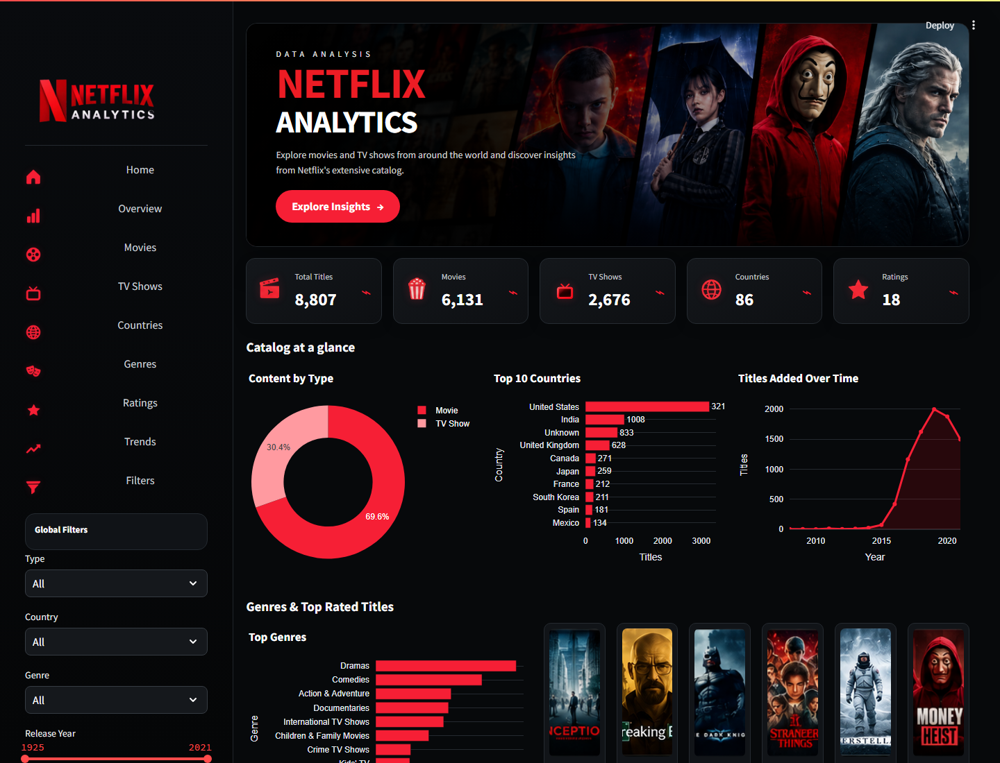
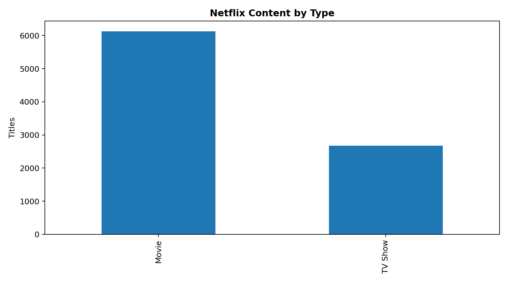
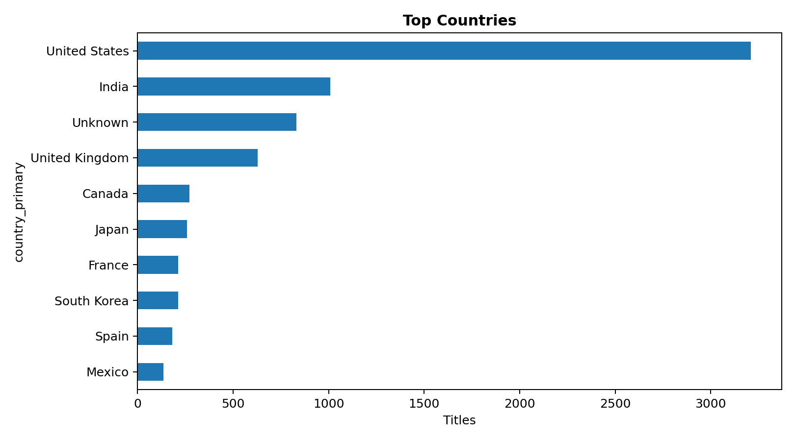
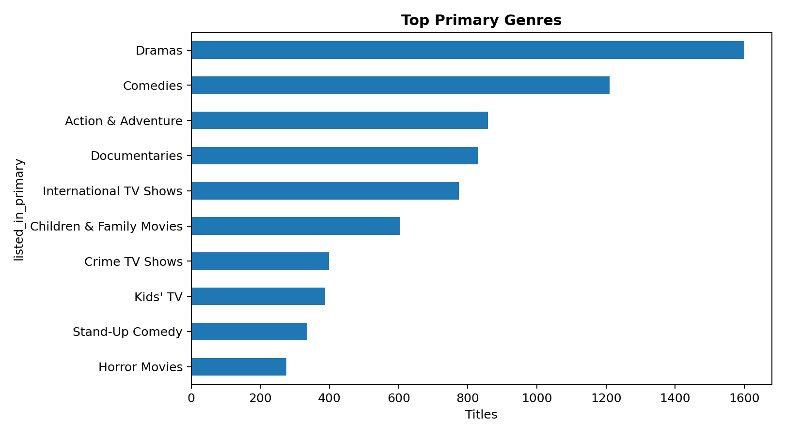
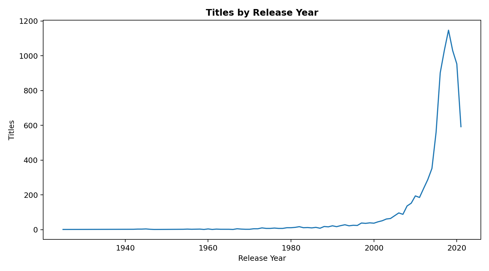

# Netflix Data Analytics Dashboard

## Semester VII Project Report

**Project Topic:** Netflix Data Analytics Dashboard  
**Prepared By:** [Student Name]  
**Roll Number:** [Roll Number]  
**Course / Department:** [Course and Department]  
**Academic Year:** [Academic Year]  
**Report Date:** 25 November 2026  
**Project Author Credited in the Repository:** Noura Maher  

> **Evidence note:** This report is based on the supplied local project files, the included raw and processed datasets, the Jupyter notebook, the generated figures, the source code, and a live check of the Streamlit dashboard. A remote GitHub repository URL was not supplied in the request or local project metadata, so no repository URL has been invented. The external Kaggle dataset page is cited separately.

---

## Table of Contents

1. Abstract  
2. Introduction  
3. Problem Statement  
4. Objectives  
5. Dataset Description  
6. Methodology  
7. Data Analysis  
8. Implementation  
9. Results and Analysis  
10. Conclusion  
11. References  

---

## 1. Abstract

The **Netflix Data Analytics Dashboard** is a descriptive data-analysis project that converts a static Netflix titles dataset into an interactive web dashboard. The project uses Python, Pandas, NumPy, Matplotlib, Plotly, Streamlit, Jupyter Notebook, and Pytest. The supplied raw dataset contains **8,807 titles and 12 attributes**, covering movies and TV shows with metadata such as title, director, cast, country, date added, release year, rating, duration, genre, and description.

The workflow includes data auditing, missing-value handling, date parsing, feature derivation, exploratory data analysis, static visualization, and dashboard development. The processed dataset contains 18 columns after deriving addition year, addition month, primary genre, primary country, duration value, and duration unit. The dashboard provides nine analysis pages and global filters for content type, country, genre, rating, and release-year range. It also provides catalog tables and filtered CSV export.

Verified results show that movies account for **6,131 titles (69.62%)**, while TV shows account for **2,676 titles (30.38%)**. The United States is the largest primary-country category, followed by India. Dramas and Comedies are the most frequent primary genres. TV-MA and TV-14 together represent approximately **60.94%** of titles. The release-year distribution peaks in **2018**, while the date-added distribution peaks in **2019**. The project demonstrates the complete descriptive data-science lifecycle, but it does not include predictive modelling, a live Netflix data feed, or machine-learning accuracy metrics. Its main limitations include first-listed country and genre simplification, incomplete saved notebook outputs, and the absence of a script that fully regenerates the processed CSV.

---

## 2. Introduction

### 2.1 Background

Netflix offers a large and diverse catalog of films, television series, documentaries, children's programming, stand-up comedy, and other content. A catalog of this size is difficult to understand through individual title records alone. Useful questions include: Which content type dominates the catalog? Which countries contribute the most titles? Which genres are most common? How has the catalog changed over time? What maturity ratings are most frequently represented?

Data analytics provides systematic methods for answering these questions. Instead of relying on manual inspection or isolated examples, analysts can aggregate records, identify missing values, compare categories, examine distributions, and present findings through visual interfaces.

### 2.2 Importance of Data Analytics

Data analytics supports decision-making by transforming raw records into structured information. In a media catalog, descriptive analysis can reveal content concentration, geographic coverage, genre diversity, rating distribution, and historical growth. Visualization makes these patterns easier to communicate, while interactive filters allow users to examine specific portions of the catalog without rewriting code.

This project is primarily an educational demonstration of descriptive analytics. It does not measure viewer behaviour, engagement, revenue, recommendation quality, or the current Netflix catalog. The results describe only the records contained in the supplied dataset snapshot.

### 2.3 Project Overview

The project combines three main components:

1. **Exploratory analysis:** A Jupyter notebook loads the raw CSV, audits missing values, performs basic cleaning, derives selected fields, and summarizes content types, release years, genres, and countries.
2. **Reusable analysis module:** A Python module provides functions for loading, cleaning, and summarizing the dataset.
3. **Interactive dashboard:** A Streamlit application reads the processed CSV and presents KPIs, interactive Plotly charts, tables, filters, and CSV download functionality.

The dashboard has a Netflix-inspired dark theme with red accents. Its nine pages are Home, Overview, Movies, TV Shows, Countries, Genres, Ratings, Trends, and Filters. A single set of global filters is applied across all pages.

---

## 3. Problem Statement

Netflix catalog data is stored as a large tabular dataset containing incomplete metadata, multi-valued fields, mixed duration formats, and date strings. Manual analysis is inefficient and makes it difficult to compare content types, countries, genres, ratings, and time periods consistently.

The project addresses the following problems:

- **Data quality:** Missing director, cast, country, date-added, rating, and duration values must be handled without removing valid titles.
- **Mixed formats:** Movie durations are expressed in minutes, while TV-show durations are expressed in seasons.
- **Multi-valued attributes:** Country and genre fields may contain several values separated by commas.
- **Temporal ambiguity:** A title's original release year is different from the year it was added to Netflix.
- **Fragmented analysis:** Separate scripts or notebooks make it difficult to explore related questions in one place.
- **Limited accessibility:** Static tables and charts do not allow non-technical users to filter the catalog interactively.
- **Reproducibility and evaluation:** The project needs a documented workflow, automated checks, and clear separation between dataset-derived results and static presentation elements.

The main problem is therefore to design and implement a reliable, understandable, and interactive descriptive analytics system for the supplied Netflix dataset while documenting its assumptions and limitations.

---

## 4. Objectives

The main objectives of the project are:

1. To load and audit the Netflix titles dataset and document its structure, size, missing values, and duplicates.
2. To clean and preprocess the data without dropping valid title records.
3. To derive analytical features such as addition year, addition month, primary country, primary genre, duration value, and duration unit.
4. To perform exploratory data analysis on content type, country, genre, rating, release year, addition date, and duration.
5. To create static visualizations that summarize the main findings.
6. To develop an interactive Streamlit dashboard with nine analysis pages and global filters.
7. To provide KPI cards, detailed tables, and filtered CSV export.
8. To validate the project through direct dataset checks and automated test assertions.
9. To document implementation details, actual results, limitations, and possible future improvements.

---

## 5. Dataset Description

### 5.1 Data Source and Scope

The project uses the local file [data/raw/netflix_titles.csv](file:///E:/Netflix-Analytics-main/data/raw/netflix_titles.csv). Its 8,807-row, 12-column structure and field names correspond to the publicly distributed **Netflix Movies and TV Shows** dataset associated with Shivam Bansal on Kaggle [2]. The repository itself does not include a formal dataset citation, license statement, retrieval date, or download script.

The dataset is a static metadata snapshot rather than a live Netflix database. The valid `date_added` values range from **1 January 2008 to 25 September 2021**, while `release_year` ranges from **1925 to 2021**.

### 5.2 Raw Dataset Attributes

| No. | Attribute | Description |
|---:|---|---|
| 1 | `show_id` | Unique identifier for each title |
| 2 | `type` | Content type: Movie or TV Show |
| 3 | `title` | Title of the movie or show |
| 4 | `director` | Director name or names |
| 5 | `cast` | Main cast members |
| 6 | `country` | Country or countries associated with the title |
| 7 | `date_added` | Date the title was added to Netflix |
| 8 | `release_year` | Original release year |
| 9 | `rating` | Netflix maturity or content rating |
| 10 | `duration` | Runtime in minutes or number of seasons |
| 11 | `listed_in` | One or more genre categories |
| 12 | `description` | Short textual description of the title |

### 5.3 Data Quality Audit

The raw dataset contains **8,807 rows, 12 columns, and no exact duplicate rows**. A total of **4,307 cells are missing**, which is approximately **4.08%** of all cells in the raw table.

| Attribute | Missing values |
|---|---:|
| `director` | 2,634 |
| `cast` | 825 |
| `country` | 831 |
| `date_added` | 10 |
| `rating` | 4 |
| `duration` | 3 |
| All other attributes | 0 |
| **Total** | **4,307** |

Additional quality issues include:

- **88 non-empty `date_added` values** have leading whitespace and are not parsed by the project's current date-conversion logic.
- **Three movie records** contain duration-like values such as `74 min`, `84 min`, and `66 min` in the `rating` column while their `duration` field is `Unknown`.
- Country and genre fields are multi-valued, but the project's analytical fields use only the first listed value.
- Two processed records have a null `country_primary` after first-value extraction; the dashboard converts these nulls to `Unknown` when loading the data.

### 5.4 Processed Dataset

The supplied [data/processed/netflix_titles_clean.csv](file:///E:/Netflix-Analytics-main/data/processed/netflix_titles_clean.csv#L1) contains **8,807 rows and 18 columns**. No title records are removed. Six fields are added:

| Derived field | Meaning |
|---|---|
| `year_added` | Year extracted from `date_added` |
| `month_added` | Month extracted from `date_added` |
| `listed_in_primary` | First comma-separated genre |
| `country_primary` | First comma-separated country |
| `duration_value` | Numeric portion of duration |
| `duration_unit` | `min`, `Season`, or `Seasons` |

The processed file has **302 missing cells**. These consist mainly of 98 missing values in each of `date_added`, `year_added`, and `month_added`, two missing `country_primary` values, and three missing values in each of `duration_value` and `duration_unit`.

---

## 6. Methodology

### 6.1 Data-Science Lifecycle

The project follows the descriptive data-science lifecycle:

| Stage | Project implementation |
|---|---|
| Problem identification | Define questions about catalog composition, geography, genres, ratings, and trends |
| Data collection | Use the included local CSV; no scraping or live API is implemented |
| Data auditing | Check shape, columns, missing values, duplicates, and date ranges |
| Data cleaning | Fill selected missing fields with `Unknown`, parse dates, and coerce invalid values |
| Feature engineering | Derive addition year/month, primary country/genre, and duration components |
| Exploratory data analysis | Count, group, sort, and compare categories and time periods |
| Visualization | Create Matplotlib figures and Plotly dashboard charts |
| Dashboard development | Build Streamlit pages, filters, KPIs, tables, and export controls |
| Evaluation | Verify dataset counts, execute test assertions, and inspect the live dashboard |
| Documentation | Provide README, requirements, summary JSON, figures, notebook, and this report |

### 6.2 Data Collection

The notebook and analysis module load `data/raw/netflix_titles.csv` using `pandas.read_csv`. The dashboard does not connect to an external service. Instead, it reads the already processed CSV. This makes the application suitable for offline demonstration but means that the results are limited to the supplied snapshot.

### 6.3 Data Auditing

The initial audit examines:

- Dataset shape and column names;
- Missing-value counts for every attribute;
- Exact duplicate rows;
- Content-type counts;
- Release-year coverage;
- Date-added coverage after parsing.

The audit confirmed 8,807 records and 12 raw attributes. No rows were dropped as duplicates.

### 6.4 Data Cleaning

The reusable module [src/analysis.py](file:///E:/Netflix-Analytics-main/src/analysis.py#L6) performs the following operations in `clean_data()`:

1. Creates a copy of the input DataFrame.
2. Replaces missing values in `director`, `cast`, `country`, `date_added`, `rating`, and `duration` with the string `Unknown`.
3. Converts `date_added` to datetime using `errors="coerce"`.
4. Derives `year_added`.
5. Extracts the first comma-separated value from `listed_in` and `country`.
6. Extracts the first integer from `duration` as `duration_value`.

The processed CSV additionally contains `month_added` and `duration_unit`. These fields are present in the dashboard input but are not generated by `clean_data()`. No reviewed source file fully reproduces the processed CSV from the raw file, which is a reproducibility limitation.

### 6.5 Feature Engineering

Feature engineering supports consistent grouping and filtering:

- `listed_in_primary` creates one primary genre per title.
- `country_primary` creates one primary country per title.
- `year_added` and `month_added` support temporal aggregation.
- `duration_value` and `duration_unit` separate numeric duration from its unit.

This design allows movies and TV shows to share one dataset while keeping minutes and seasons conceptually distinct.

### 6.6 Exploratory Data Analysis

The notebook [notebooks/Netflix_Analytics_Final.ipynb](file:///E:/Netflix-Analytics-main/notebooks/Netflix_Analytics_Final.ipynb) contains eight cells. Its code loads the raw CSV, displays structural and missing-value information, applies cleaning, derives selected features, counts content types, plots the latest 20 represented release years, and prints the top primary genres and countries.

The notebook's six code cells have no saved execution counts or outputs in the supplied file. Therefore, numerical findings in this report were recomputed directly from the CSV files rather than quoted from notebook output.

### 6.7 Visualization and Dashboard Development

Four static Matplotlib figures are included:

- Content type;
- Release-year distribution;
- Top primary countries;
- Top primary genres.

The dashboard uses Plotly Express for interactive charts. Plotly figures are passed to Streamlit through `st.plotly_chart`, with custom dark styling, red/pink colour mapping, transparent backgrounds, and disabled or simplified chart toolbars depending on the page.

### 6.8 Validation

Validation includes:

- Confirming that raw and processed row counts remain 8,807;
- Confirming that Movie and TV Show counts sum to the total;
- Checking missing-value and duplicate counts;
- Recomputing all reported statistics from the datasets;
- Executing the two project test functions directly;
- Loading the dashboard and applying a Movie filter;
- Capturing a dashboard screenshot for visual evidence.

Because the project is descriptive rather than predictive, no classification accuracy, precision, recall, F1-score, or prediction error is applicable.

---

## 7. Data Analysis

### 7.1 Content-Type Analysis

Content-type analysis compares the number of movies and TV shows. The dashboard displays the comparison as a donut chart, KPI cards, and grouped charts. This establishes the basic composition of the catalog and provides a filter for more detailed analysis.

### 7.2 Geographic Analysis

Geographic analysis uses `country_primary`. It ranks countries by title count, compares Movies versus TV Shows, measures the number of primary genres represented per country, and examines additions over time for the top countries. The Countries page excludes `Unknown` from its top-country selection, while the Home page includes it in the top-ten chart.

### 7.3 Genre Analysis

Genre analysis uses `listed_in_primary`. It identifies dominant genres, compares the movie/TV mix within each leading genre, tracks additions over time for the top six genres, and measures geographic reach. The primary-genre approach simplifies multi-label data but underrepresents secondary genres.

### 7.4 Rating Analysis

Rating analysis treats `rating` as a maturity/content category. It shows rating frequency, compares ratings by content type, tracks the top ratings over time, and calculates average release year by rating. These ratings are not user scores and should not be interpreted as audience satisfaction.

### 7.5 Temporal Analysis

Two different temporal variables are analyzed:

- **`release_year`:** The year a title was originally released.
- **`date_added`:** The year or month a title entered the Netflix catalog in the snapshot.

Separating these variables prevents original release trends from being confused with Netflix catalog-growth trends.

### 7.6 Duration Analysis

For movies, `duration_value` is interpreted as runtime in minutes. For TV shows, it is interpreted as the number of seasons. The Movies page includes a runtime histogram and average duration; the TV Shows page includes a season distribution and average season count.

### 7.7 Filtered Analysis

The global filters combine content type, primary country, primary genre, rating, and an inclusive release-year range using logical AND conditions. Every page responds to the same filtered DataFrame. The Filters page also exposes matching-title counts, distinct country/genre/rating counts, charts, a catalog table, and CSV download.

---

## 8. Implementation

### 8.1 Technologies and Libraries

| Technology | Role in the project |
|---|---|
| Python | Primary programming language |
| Pandas | CSV loading, cleaning, filtering, and aggregation |
| NumPy | Numerical support for Pandas and plotting |
| Matplotlib | Static analytical figures |
| Plotly Express | Interactive dashboard charts |
| Streamlit | Web application and user interface |
| Jupyter Notebook | Exploratory analysis workflow |
| Pytest | Automated test framework declared in requirements |

The dependencies are listed in [requirements.txt](file:///E:/Netflix-Analytics-main/requirements.txt).

### 8.2 Project Structure

```text
Netflix-Analytics-main/
├── app/
│   ├── app.py
│   └── run_app.bat
├── assets/
│   ├── backgrounds/
│   ├── branding/
│   ├── hero/
│   ├── icons/
│   ├── kpi/
│   └── posters/
├── data/
│   ├── raw/netflix_titles.csv
│   └── processed/netflix_titles_clean.csv
├── figures/
│   ├── content_type.png
│   ├── release_years.png
│   ├── top_countries.png
│   └── top_genres.png
├── notebooks/
│   └── Netflix_Analytics_Final.ipynb
├── reports/
│   ├── FINAL_REPORT.md
│   ├── summary.json
│   └── PROJECT_REPORT.md
├── src/
│   └── analysis.py
├── tests/
│   └── test_analysis.py
├── requirements.txt
└── README.md
```

### 8.3 Reusable Analysis Module

The module [src/analysis.py](file:///E:/Netflix-Analytics-main/src/analysis.py) contains:

- `load_data(path)`: Reads a CSV into a Pandas DataFrame.
- `clean_data(df)`: Fills selected missing values, parses dates, and derives analytical fields.
- `kpis(df)`: Returns total titles, movie count, TV-show count, and distinct primary-country count.

The dashboard does not import this module. The module is currently exercised by the test file and notebook workflow rather than serving as the dashboard's runtime data layer.

### 8.4 Dashboard Architecture

The main application is [app/app.py](file:///E:/Netflix-Analytics-main/app/app.py#L6). It is a single-file Streamlit application rather than Streamlit's native multipage system.

Its main components are:

1. **Configuration:** Sets the page title, icon, wide layout, and expanded sidebar.
2. **Data loading:** Reads the processed CSV with `@st.cache_data`, reparses dates, coerces numeric fields, and fills selected categorical nulls.
3. **Asset helpers:** Convert local images to base64 so logos, icons, posters, and hero images can be embedded.
4. **Theme:** Applies custom HTML/CSS for the dark interface, cards, sidebar, hero, and footer.
5. **Navigation:** Stores the active page in `st.session_state.page`.
6. **Global filters:** Creates single-select controls and a release-year slider.
7. **Filtering:** Applies all active conditions to a copied DataFrame.
8. **Rendering functions:** Build the content for each page.
9. **Router:** Calls the appropriate rendering function based on the active page.
10. **Export:** Converts the filtered records to UTF-8 CSV for download.

Only data loading is cached. Filtering, aggregation, chart construction, image encoding, and CSV generation run again when the app reruns.

### 8.5 Dashboard Pages

| Page | Main features |
|---|---|
| Home | Hero section, five KPIs, content mix, top countries, additions trend, top genres, static title showcase |
| Overview | Catalog composition, ratings, release years, monthly additions, countries, and genres |
| Movies | Movie KPIs, release trends, genres, countries, ratings, runtime distribution, and catalog table |
| TV Shows | TV KPIs, release trends, genres, countries, ratings, season distribution, and catalog table |
| Countries | Top-15 countries, Movie/TV comparison, genre variety, additions trends, and summary table |
| Genres | Top genres, content-type mix, genre trends, geographic reach, and detail table |
| Ratings | Rating distribution, content-type comparison, rating trends, average release year, and detail table |
| Trends | Yearly additions, Movie/TV additions, monthly additions, release-year profile, YoY growth, and recent-year cards |
| Filters | Filtered KPIs, charts, detailed records, and CSV export |

### 8.6 Visual Assets

The project includes branding logos, a cinema background, a hero image, navigation icons, KPI icons, and poster thumbnails. These assets improve the visual presentation but are not analytical data sources. The static title showcase on the Home page is hardcoded in `top_posters()` and is not calculated from the dataset.

### 8.7 Running the Application

From the project root, the dashboard is started with:

```bash
py -m streamlit run app/app.py
```

It is normally available at:

```text
http://localhost:8501
```

The Windows batch file [app/run_app.bat](file:///E:/Netflix-Analytics-main/app/run_app.bat) changes to the project root, starts Streamlit, and pauses. It does not install dependencies or open a browser automatically.

### 8.8 Dashboard Output



**Figure 1** shows the sidebar navigation, global filters, hero section, KPI cards, content-type donut chart, top-country bar chart, additions trend, top-genre chart, and static title showcase. The screenshot was captured from the live local dashboard with all filters set to their default values.

---

## 9. Results and Analysis

### 9.1 Catalog Composition

| Content type | Titles | Percentage |
|---|---:|---:|
| Movie | 6,131 | 69.62% |
| TV Show | 2,676 | 30.38% |
| **Total** | **8,807** | **100.00%** |

Movies are approximately 2.29 times as numerous as TV shows in the supplied snapshot. This establishes movies as the larger component of the catalog.



**Figure 2** visually confirms the difference between movie and TV-show counts.

### 9.2 Geographic Distribution

The following values use the dashboard-equivalent country category, where two null primary-country values are converted to `Unknown` during application loading.

| Rank | Primary country | Titles | Percentage of all titles |
|---:|---|---:|---:|
| 1 | United States | 3,211 | 36.46% |
| 2 | India | 1,008 | 11.45% |
| 3 | Unknown | 833 | 9.46% |
| 4 | United Kingdom | 628 | 7.13% |
| 5 | Canada | 271 | 3.08% |
| 6 | Japan | 259 | 2.94% |
| 7 | France | 212 | 2.41% |
| 8 | South Korea | 211 | 2.40% |
| 9 | Spain | 181 | 2.06% |
| 10 | Mexico | 134 | 1.52% |

The United States is the dominant primary-country category. India is the second-largest named category, followed by the United Kingdom. The `Unknown` category represents missing country metadata and should not be interpreted as a real production country.



**Figure 3** shows the strong concentration in the leading country categories and the much smaller counts for the remaining top-ten countries.

### 9.3 Genre Distribution

| Rank | Primary genre | Titles | Percentage |
|---:|---|---:|---:|
| 1 | Dramas | 1,600 | 18.17% |
| 2 | Comedies | 1,210 | 13.74% |
| 3 | Action & Adventure | 859 | 9.75% |
| 4 | Documentaries | 829 | 9.41% |
| 5 | International TV Shows | 774 | 8.79% |
| 6 | Children & Family Movies | 605 | 6.87% |
| 7 | Crime TV Shows | 399 | 4.53% |
| 8 | Kids' TV | 388 | 4.41% |
| 9 | Stand-Up Comedy | 334 | 3.79% |
| 10 | Horror Movies | 275 | 3.12% |

Dramas and Comedies are the two most common primary genres. The distribution also shows meaningful representation of documentaries, international television, children's programming, crime television, and stand-up comedy.



**Figure 4** summarizes the leading genre categories using the first listed genre for each title.

### 9.4 Rating Distribution

| Rating | Titles | Percentage |
|---|---:|---:|
| TV-MA | 3,207 | 36.41% |
| TV-14 | 2,160 | 24.53% |
| TV-PG | 863 | 9.80% |
| R | 799 | 9.07% |
| PG-13 | 490 | 5.56% |
| TV-Y7 | 334 | 3.79% |
| TV-Y | 307 | 3.49% |
| PG | 287 | 3.26% |

TV-MA and TV-14 together account for **5,367 titles, or approximately 60.94%** of the catalog. This indicates that mature or teen-oriented rating categories are prominent in the snapshot. The result does not measure audience preference or viewing frequency.

### 9.5 Release-Year and Addition Trends

The release-year range is **1925–2021**. The largest release-year count occurs in **2018 with 1,147 titles**. Subsequent counts are:

| Release year | Titles |
|---:|---:|
| 2018 | 1,147 |
| 2019 | 1,030 |
| 2020 | 953 |
| 2021 | 592 |



**Figure 5** shows very low representation in earlier decades, growth from the 2000s onward, a peak in the late 2010s, and a decline in the final observed years. The decline should not be interpreted as a complete market trend because the dataset is a snapshot and the final year is incomplete.

For `date_added`, **8,709 records** have valid parsed dates and **98 records** are missing or unparsed. The valid date range is **1 January 2008 to 25 September 2021**.

| Addition year | Titles added |
|---:|---:|
| 2016 | 418 |
| 2017 | 1,164 |
| 2018 | 1,625 |
| 2019 | 1,999 |
| 2020 | 1,878 |
| 2021 | 1,498 |

The addition series peaks in **2019**. The 2021 count covers only the period ending on 25 September, so it is not directly comparable with complete calendar years.

### 9.6 Duration and Season Analysis

| Measure | Movies | TV Shows |
|---|---:|---:|
| Valid duration count | 6,128 | 2,676 |
| Missing duration count | 3 | 0 |
| Mean | 99.58 minutes | 1.76 seasons |
| Median | 98 minutes | 1 season |
| Minimum | 3 minutes | 1 season |
| Maximum | 312 minutes | 17 seasons |

The mean movie runtime rounds to **100 minutes** in the dashboard. For TV shows, **1,793 titles (67.00%)** have exactly one season, indicating that single-season series are common in the supplied catalog. The minimum movie runtime of three minutes is an observed data value and should be treated cautiously as a possible data-quality outlier.

### 9.7 Content-Type Comparison

| Metric | Movies | TV Shows |
|---|---:|---:|
| Titles | 6,131 | 2,676 |
| Top primary country | United States: 2,364 | United States: 847 |
| Top primary genre | Dramas: 1,600 | International TV Shows: 774 |
| Top rating | TV-MA: 2,062 | TV-MA: 1,145 |
| Duration measure | Mean 99.58 minutes | Mean 1.76 seasons |

This comparison demonstrates why separate Movies and TV Shows pages are useful: the two content types differ not only in count but also in dominant genres and the interpretation of duration.

### 9.8 Functional Evaluation

The following checks were performed:

- Raw row count: **8,807 — confirmed**.
- Processed row count: **8,807 — confirmed**.
- Movie count plus TV-show count: **6,131 + 2,676 = 8,807 — confirmed**.
- Exact duplicate rows: **0 — confirmed**.
- `test_load_and_clean`: **passed** when executed directly.
- `test_kpis`: **passed** when executed directly.
- Live dashboard load: **successful**.
- Global Type filter set to Movie: the dashboard updated the total to **6,131** after rerun.
- Dashboard screenshot: captured successfully using a headless browser.

The standard command `py -m pytest -q` could not be executed because the active Python environment did not contain the `pytest` package. To avoid claiming an unperformed test run, both test functions were imported and executed directly; all assertions passed.

### 9.9 Limitations

1. **Static snapshot:** The dataset ends in September 2021 and does not represent the current Netflix catalog.
2. **Incomplete year:** The 2021 addition count is partial and should not be compared directly with complete years.
3. **Primary-value simplification:** Only the first country and genre are used, so co-productions and secondary genres are not fully counted.
4. **Date parsing:** Leading whitespace causes 88 non-empty date values to become missing; together with 10 originally missing values, 98 dates are unavailable for temporal analysis.
5. **Rating anomalies:** Three duration-like values appear in the rating field and remain visible as unusual categories.
6. **Notebook evidence:** The supplied notebook has no saved outputs, and the four static figures are not reproducibly linked to notebook cells.
7. **Processed-data reproducibility:** No reviewed script generates all 18 processed columns from the raw CSV.
8. **Static presentation elements:** The Home page's title ratings are hardcoded, and the hero's `Explore Insights` control is visual rather than functional.
9. **Limited test coverage:** The tests check row count, the presence of `year_added`, total titles, and the movie/TV relationship; they do not test cleaning edge cases, filters, charts, or export behavior.
10. **No predictive evaluation:** The project performs descriptive analytics only, so model-based performance metrics do not apply.

### 9.10 Future Improvements

Possible improvements include:

- Adding a script that regenerates the processed CSV from the raw file.
- Stripping whitespace before date parsing.
- Correcting or explicitly handling misplaced duration values in the rating field.
- Supporting multi-label country and genre analysis.
- Executing the notebook and saving its outputs.
- Connecting static figures to documented generation code.
- Replacing the hardcoded title showcase with clearly labelled static content or dataset-derived metrics.
- Making the hero control functional.
- Adding tests for missing values, invalid dates, filters, page rendering, and CSV export.
- Updating the dataset if a newer licensed snapshot becomes available.

---

## 10. Conclusion

The Netflix Data Analytics Dashboard successfully demonstrates the descriptive data-science lifecycle from problem identification and data collection through cleaning, feature engineering, exploratory analysis, visualization, dashboard implementation, and evaluation. The project analyzes 8,807 titles and provides an interactive interface for exploring content type, geography, genres, ratings, release years, addition trends, and duration.

The verified findings show a movie-dominated catalog, strong geographic concentration in the United States and India, frequent Drama and Comedy categories, a high combined share of TV-MA and TV-14 ratings, a release-year peak in 2018, and an addition-year peak in 2019. The dashboard's filters, KPI cards, tables, and CSV export make these findings accessible to non-technical users.

The project also exposes several important academic lessons: static snapshots require temporal caution; multi-valued fields need explicit simplification or explosion strategies; missing and malformed metadata affect analysis; and reproducibility requires saved outputs and complete generation scripts. Addressing the documented limitations would improve reliability and maintainability. Overall, the project is a complete and useful Semester VII demonstration of descriptive data analytics and interactive dashboard development, while remaining appropriately limited to the data and features actually implemented.

---

## 11. References

1. **Noura Maher.** *Netflix Analytics Dashboard.* Local project files supplied for this report, including [README.md](file:///E:/Netflix-Analytics-main/README.md), [app/app.py](file:///E:/Netflix-Analytics-main/app/app.py), [src/analysis.py](file:///E:/Netflix-Analytics-main/src/analysis.py), the notebook, datasets, figures, and tests. Remote GitHub repository URL was not provided.

2. **Shivam Bansal.** *Netflix Movies and TV Shows.* Kaggle. Available at: https://www.kaggle.com/datasets/shivamb/netflix-shows. Accessed 25 November 2026.

3. **Pandas Development Team.** *Pandas Documentation.* https://pandas.pydata.org/docs/

4. **Matplotlib Development Team.** *Matplotlib Documentation.* https://matplotlib.org/stable/contents.html

5. **Plotly Technologies Inc.** *Plotly Python Graphing Library.* https://plotly.com/python/

6. **Streamlit.** *Streamlit Documentation.* https://docs.streamlit.io/

7. **Streamlit.** *st.plotly_chart — API Reference.* https://docs.streamlit.io/develop/api-reference/charts/st.plotly_chart

8. **Pytest.** *Pytest Documentation.* https://docs.pytest.org/

Sources:
- [Netflix Movies and TV Shows — Kaggle](https://www.kaggle.com/datasets/shivamb/netflix-shows)
- [Streamlit Documentation](https://docs.streamlit.io/)
- [Streamlit st.plotly_chart API Reference](https://docs.streamlit.io/develop/api-reference/charts/st.plotly_chart)
